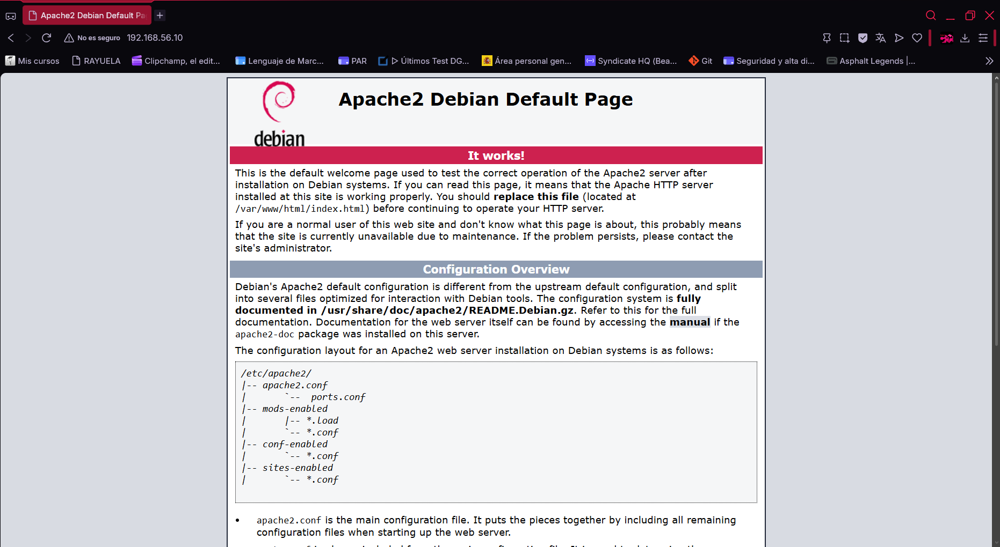
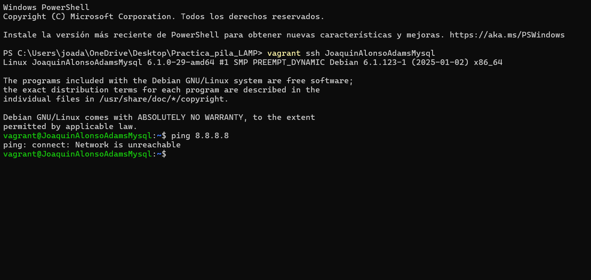

# Practica_pila_LAMP

Este repositorio contiene la configuración, scripts de aprovisionamiento y documentación técnica para desplegar una arquitectura LAMP (Linux, Apache, MySQL, PHP) dividida en dos niveles mediante Vagrant utilizando el box de Debian 12 (debian/bookworm64).

## 1. Estructura del Repositorio
```
├── Vagrantfile # Archivo principal de orquestación de máquinas virtuales
├── Readme.md # Documento técnico explicativo del proyecto
├── scripts/
│ ├── provision_web.sh # Script de aprovisionamiento del Servidor Web
│ └── provision_db.sh # Script de aprovisionamiento del Servidor de Base de Datos
└── img/ # Capturas de pantalla de evidencia
├── apache_status.png
└── mysql_status.png
```

## 2. Configuración de la Arquitectura (Vagrantfile)
A continuación se detalla el contenido del archivo Vagrantfile, el cual orquesta las dos máquinas virtuales requeridas:
```
# -*- mode: ruby -*-
# vi: set ft=ruby :
Vagrant.configure("2") do |config|
# Box base: Debian 12 (Bookworm)
config.vm.box = "debian/bookworm64"

# ==========================================================
# 1. Servidor Web (Apache + PHP)
# ==========================================================
config.vm.define "JoaquinAlonsoAdamsApache" do |web|
web.vm.hostname = "JoaquinAlonsoAdamsApache"
None
# Red privada interna para comunicarse con la base de datos
web.vm.network "private_network", ip: "192.168.56.10"
# Port Forwarding: Acceso desde el host (puerto 8080) al Apache (puerto 80)
web.vm.network "forwarded_port", guest: 80, host: 8080, host_ip: "127.0.0.1"
# Aprovisionamiento mediante Script Bash
web.vm.provision "shell", path: "scripts/provision_web.sh"
# Configuración de recursos VirtualBox
web.vm.provider "virtualbox" do |vb|
vb.name = "JoaquinAlonsoAdamsApache"
vb.memory = "1024"
vb.cpus = 1
end
end

# ==========================================================
# 2. Servidor de Base de Datos (MySQL / MariaDB)
# ==========================================================
config.vm.define "JoaquinAlonsoAdamsApache" do |db|
db.vm.hostname = "JoaquinAlonsoAdamsApache"
# Red privada interna (aislada)
db.vm.network "private_network", ip: "192.168.56.20"
# Aprovisionamiento mediante Script Bash
db.vm.provision "shell", path: "scripts/provision_db.sh"
# Configuración de recursos VirtualBox
db.vm.provider "virtualbox" do |vb|
vb.name = "JoaquinAlonsoAdamsApache"
vb.memory = "1024"
vb.cpus = 1
end
end
end
```

## 3. Scripts de Aprovisionamiento Bash Explicados
3.1 Servidor Web (scripts/provision_web.sh)
```
#!/usr/bin/env bash
# Detener ejecución si ocurre cualquier error
set -e
echo "[+] Configurando Servidor Web: JoaquinAlonsoAdamsApache"
# Evita avisos interactivos durante la instalación
export DEBIAN_FRONTEND=noninteractive
echo "[+] Actualizando repositorios e instalando paquetes..."
apt-get update -y
apt-get install -y apache2 php libapache2-mod-php php-mysql git
echo "[+] Habilitando e iniciando servicio Apache..."
systemctl enable apache2
systemctl start apache2
echo "[+] Generando archivo de prueba PHP..."
cat << 'EOF' > /var/www/html/info.php
<?php
phpinfo();
?>
EOF
echo "[+] Verificando conectividad interna con la BD (192.168.56.20)..."
ping -c 2 192.168.56.20 || echo "[!] La base de datos aún no está disponible."
echo "[+] Aprovisionamiento del servidor Web completado exitosamente."
```

Explicación de Comandos (provision_web.sh):
1. set -e: Asegura que el script falle inmediatamente si alguno de los comandos devuelve un código de error distinto de cero.
2. export DEBIAN_FRONTEND=noninteractive: Inhabilita las interfaces gráficas y preguntas emergentes de apt-get durante las instalaciones.
3. apt-get update -y && apt-get install -y apache2 php libapache2-mod-php php-mysql git: Actualiza el índice de paquetes e instala el servidor web Apache, el intérprete PHP, el conector PHP-MySQL y Git.
4. systemctl enable apache2 / systemctl start apache2: Activa Apache para que arranque automáticamente junto con el sistema y lo inicia en el momento.
None
5. cat << 'EOF' > /var/www/html/info.php: Crea una página PHP dinámica de prueba para verificar que el servidor procesa correctamente el lenguaje.

3.2 Servidor de Base de Datos (scripts/provision_db.sh)
```
#!/usr/bin/env bash
# Detener ejecución si ocurre cualquier error
set -e
echo "[+] Configurando Servidor de Base de Datos: JoseLuisGomezMysql"
# Evita avisos interactivos durante la instalación
export DEBIAN_FRONTEND=noninteractive
echo "[+] Actualizando e instalando MariaDB Server..."
apt-get update -y
apt-get install -y mariadb-server
echo "[+] Eliminando Default Gateway en eth0 (Restricción de acceso a Internet)..."
# Remueve la ruta por defecto a Internet asignada a la interfaz NAT de Vagrant
ip route del default dev eth0 || true
echo "[+] Permitiendo conexiones remotas desde el servidor web..."
# Reemplaza la escucha local (127.0.0.1) por todas las interfaces (0.0.0.0)
sed -i 's/127.0.0.1/0.0.0.0/' /etc/mysql/mariadb.conf.d/50-server.cnf
echo "[+] Reiniciando MariaDB..."
systemctl restart mariadb
systemctl enable mariadb
echo "[+] Creando base de datos y otorgando permisos al Servidor Web..."
mysql -u root << 'EOF'
CREATE DATABASE IF NOT EXISTS lamp_db;
CREATE USER IF NOT EXISTS 'lamp_user'@'192.168.56.10' IDENTIFIED BY 'PasswordSegura123!';
GRANT ALL PRIVILEGES ON lamp_db.* TO 'lamp_user'@'192.168.56.10';
FLUSH PRIVILEGES;
EOF
echo "[+] Aprovisionamiento del servidor de Base de Datos completado exitosamente."
None
None
```

Explicación de Comandos (provision_db.sh):
1. ip route del default dev eth0 || true: Elimina la ruta por defecto a Internet de la interfaz de red NAT (eth0). Esto garantiza que la máquina no tenga ningún tipo de acceso a Internet.
2. sed -i 's/127.0.0.1/0.0.0.0/' /etc/mysql/mariadb.conf.d/50-server.cnf: Modifica la directiva bind-address en la configuración de MariaDB/MySQL para permitir conexiones procedentes de la red privada interna.
3. mysql -u root << 'EOF' ... EOF: Ejecuta las sentencias SQL necesarias para crear la base de datos lamp_db y el usuario lamp_user, restringiendo los accesos exclusivamente a la dirección IP del servidor web (192.168.56.10).
   
## 4. Evidencias de Funcionamiento
4.1 Estado del Servidor Web (JoaquinAlonsoAdamsApache)


4.2 Estado del Servidor DB y Aislamiento de Red (JoaquinAlonsoAdamsMYSQL)


